# Trama: Red social editorial

> Historias que se quedan contigo. Un espacio sosegado para escribir, leer y compartir reflexiones y pequeñas verdades de cada día.

---

## 1. Presentación del proyecto

**Trama** es una plataforma de interacción social con impronta editorial y literaria, concebida para contrarrestar la inmediatez y la saturación algorítmica de las redes convencionales. Su propósito es ofrecer una atmósfera íntima y pausada donde las personas puedan publicar microensayos, crónicas cotidianas, fragmentos de lectura y reflexiones personales, disfrutando de una experiencia de lectura limpia, tipográficamente cuidada y sin distracciones superficiales.

La arquitectura del sistema está organizada como un monorepositorio que combina:
* **Backend:** API REST desarrollada con el framework **NestJS**, tipado estricto en TypeScript y persistencia de datos orientada a documentos en **MongoDB** mediante **Mongoose**.
* **Frontend:** Aplicación cliente de una sola página desarrollada en **Angular** (versión 20+), empleando componentes autónomos (*standalone components*), control de flujo nativo (`@if`, `@for`, `@switch`), reactividad moderna basada en señales (*Signals*) y estilos resueltos exclusivamente con **CSS puro**.

---

## 2. Cronograma y estado de los sprints

El ciclo de desarrollo del proyecto está estructurado en cuatro iteraciones:

| Iteración | Fecha límite de entrega | Alcance temático principal | Estado actual |
| :--- | :--- | :--- | :--- |
| **Sprint 1** | **04/11/2026** | **Fundamentos, autenticación, identidad visual y estructura base** | **Completado al 100%** |
| **Sprint 2** | **11/11/2026** | **Muro de historias, creación, detalle, comentarios y reacciones** | **Completado al 100%** |
| **Sprint 3** | **18/11/2026** | **Perfil personal, edición de cuenta, control de sesión e imágenes** | **Completado al 100%** |
| **Sprint 4** | **25/11/2026** | **Administración, estadísticas, gestión de usuarios y PWA** | **Completado al 100%** |

### 2.1. Alcance completado por sprint

#### Sprint 1: Fundamentos y autenticación
* [x] Monorepositorio con NestJS (backend) y Angular (frontend) con scripts concurrentes (`npm run start:all`).
* [x] Base de datos MongoDB Atlas con Mongoose y esquema `User` con bajas lógicas (`isActive`).
* [x] Autenticación mediante JWT, encriptación con `bcrypt` y endpoints de registro e inicio de sesión.
* [x] Pantallas de inicio de sesión (`/login`), registro (`/register`) y transición (`/loading`).
* [x] Barra de navegación (`NavbarComponent`) con conmutador de tema claro/oscuro y menú de usuario.
* [x] Identidad editorial, maquetación con CSS puro nativo y erradicación total de emojis.

#### Sprint 2: Historias, comentarios y reacciones
* [x] Feed de publicaciones (`/posts`) con diseño de tarjeta editorial, vista previa y metadatos del autor.
* [x] Editor modal de publicaciones con conteo en tiempo real de palabras y caracteres.
* [x] Subida opcional de imágenes optimizadas a Cloudinary con previsualización inmediata.
* [x] Sistema reactivo de «me gusta» con actualización optimista y persistencia en base de datos.
* [x] Paginación bajo demanda con botón «Cargar más historias» y ordenamiento por fecha o cantidad de reacciones.
* [x] Pantalla de detalle de publicación (`/posts/:id`) con visualización completa del ensayo.
* [x] Hilo de comentarios con paginación, formulario reactivo de respuesta y borrado lógico.
* [x] Modal personalizado de confirmación de eliminación de publicaciones para el autor o administrador.

#### Sprint 3: Perfil, control de sesión y multimedia
* [x] Pantalla de perfil personal (`/profile`) con métricas de autoría, fecha de registro y biografía.
* [x] Listado de historias propias publicadas con acciones directas de visualización y borrado.
* [x] Modal de edición de perfil con actualización de nombres, usuario, fecha de nacimiento, biografía y foto de perfil.
* [x] Control proactivo de caducidad de sesión mediante token JWT y modal de advertencia preventiva (`SessionModalComponent`).
* [x] Renovación silenciosa de sesión (*refresh token*) o cierre seguro tras inactividad.

#### Sprint 4: Administración, métricas y PWA
* [x] Sistema de control de acceso basado en roles (`administrador` y `usuario`) con guardias de ruta (`AdminGuard` y `AuthGuard`).
* [x] Directorio administrativo de usuarios (`/dashboard`):
  * Tarjetas de métricas consolidadas (total de usuarios, activos, deshabilitados y administradores).
  * Buscador reactivo en tiempo real por nombre, usuario o correo electrónico.
  * Control tipo interruptor (*switch*) accesible para habilitar o deshabilitar cuentas con modal de confirmación.
  * Formulario modal para el alta de nuevos usuarios con asignación de perfil de permisos.
* [x] Módulo de estadísticas visuales (`/dashboard/estadisticas`):
  * Gráfico de barras SVG de publicaciones por usuario.
  * Gráfico de línea temporal SVG de evolución de comentarios en el tiempo.
  * Gráfico de dona SVG para la distribución de comentarios por historia.
  * Filtros de lapso temporal interactivos (7 días, 30 días, 90 días, historial completo o rango de fechas manual).
* [x] Progressive Web App (PWA):
  * Manifiesto web (`manifest.webmanifest`) configurado en modo `standalone`, con paleta editorial e íconos adaptables.
  * Service Worker con `@angular/service-worker` para almacenamiento en caché estática y soporte sin conexión (*offline*).
* [x] Experiencia de modales accesible con bloqueo estricto de desplazamiento del fondo (`body.modal-open` y `html.modal-open`).

---

## 3. Índice de pantallas desarrolladas

El sistema cuenta actualmente con las siguientes vistas funcionales y componentes estructurales:

### 3.1. Pantalla de inicio de sesión (`/login`)
* **Propósito:** Brindar acceso seguro a los usuarios registrados en la red.
* **Características:**
  * Permite identificarse indistintamente mediante correo electrónico o nombre de usuario.
  * Campo de contraseña con conmutador de visibilidad que alterna entre texto oculto y visible mediante icono SVG nativo.
  * Botón de acción con retroalimentación visual de estado de carga (*«Iniciando sesión...»*).
  * Enlace al pie para acceder al formulario de registro en caso de no poseer cuenta.

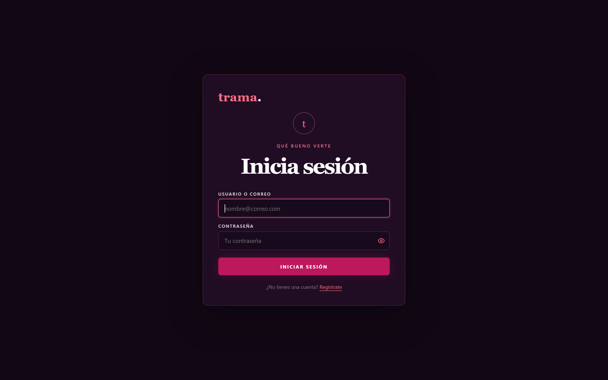

### 3.2. Pantalla de creación de cuenta (`/register`)
* **Propósito:** Permitir el alta completa de nuevos integrantes en la comunidad.
* **Características:**
  * Maquetación en dos columnas: columna izquierda editorial con la bienvenida de Trama y columna derecha con el formulario reactivo.
  * Validación alfabética estricta en los campos de nombre y apellido, restringiendo números y caracteres especiales.
  * Validador de fortaleza de contraseña (mínimo 8 caracteres, al menos 1 letra mayúscula y 1 dígito numérico) y coincidencia exacta en la repetición de clave.
  * Selector de fecha de nacimiento con icono de calendario estilizado en el tono rosa corporativo.
  * Selector de fotografía de perfil con carga de archivo y previsualización circular inmediata.
  * Botón de acción reactivo con manejo de errores específicos por campo.

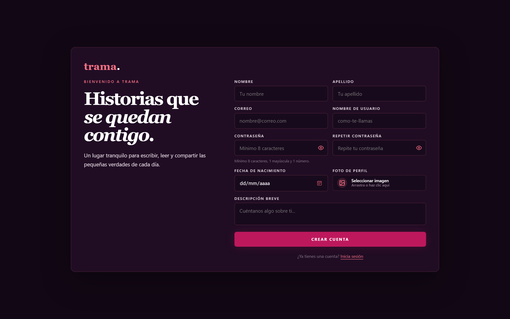

### 3.3. Pantalla de carga y espera (`/loading`)
* **Propósito:** Servir como transición de carga sosegada para operaciones asíncronas o precargas de datos.
* **Características:**
  * Fondo inmersivo con viñeta radial.
  * Disco central con la letra inicial de Trama rodeado por dos anillos concéntricos con animación de pulsación suave en CSS puro.
  * Leyenda inferior con tipografía serif en estilo *sentence case*: *«Tejiendo historias...»*.

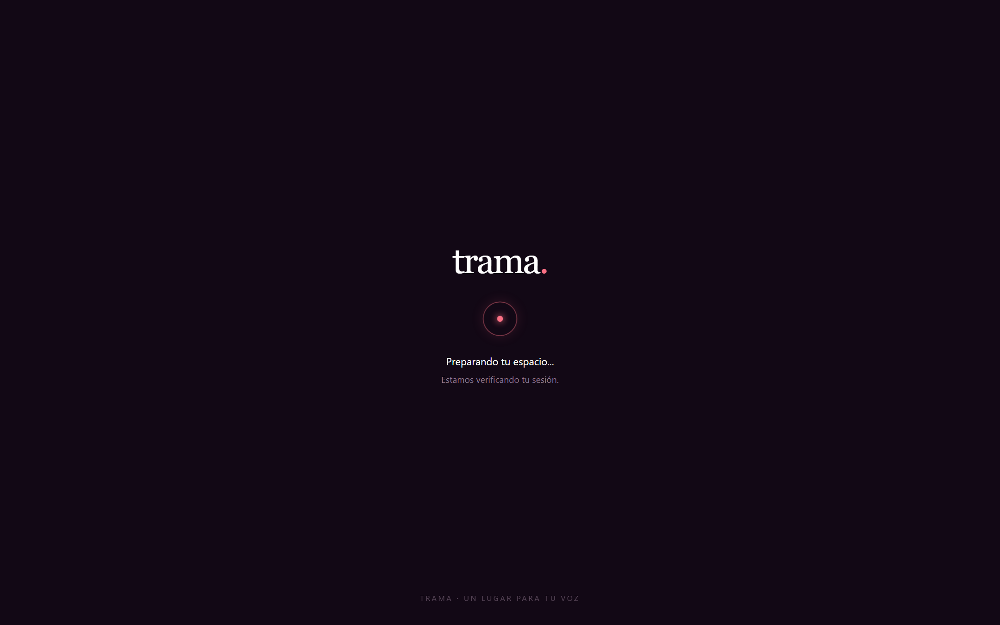

### 3.4. Pantalla del muro de publicaciones (`/posts`)
* **Propósito:** Espacio central de lectura y descubrimiento de relatos, crónicas y microensayos.
* **Características:**
  * Listado paginado bajo demanda con botón «Cargar más historias» para preservar un consumo pausado y eficiente.
  * Selector de ordenamiento dinámico: «Más recientes», «Más antiguas» y «Más valoradas».
  * Tarjetas de publicación con diseño editorial: avatar del autor, fecha de publicación amigable, fragmento de lectura con opción de desplegar texto completo, imagen fotográfica optimizada y contador reactivo de reacciones.
  * Interacción de «me gusta» con actualización optimista inmediata en la interfaz y persistencia en base de datos.
  * Modal para redactar y publicar historias con conteo en tiempo real de palabras y caracteres, selector opcional de imagen y bloqueo estricto del desplazamiento de fondo.
  * Botón flotante accesible y botón de cabecera «Nueva historia» para agilizar la creación desde cualquier punto del muro.

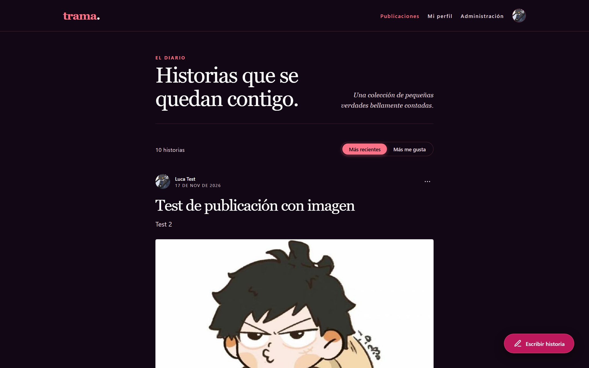

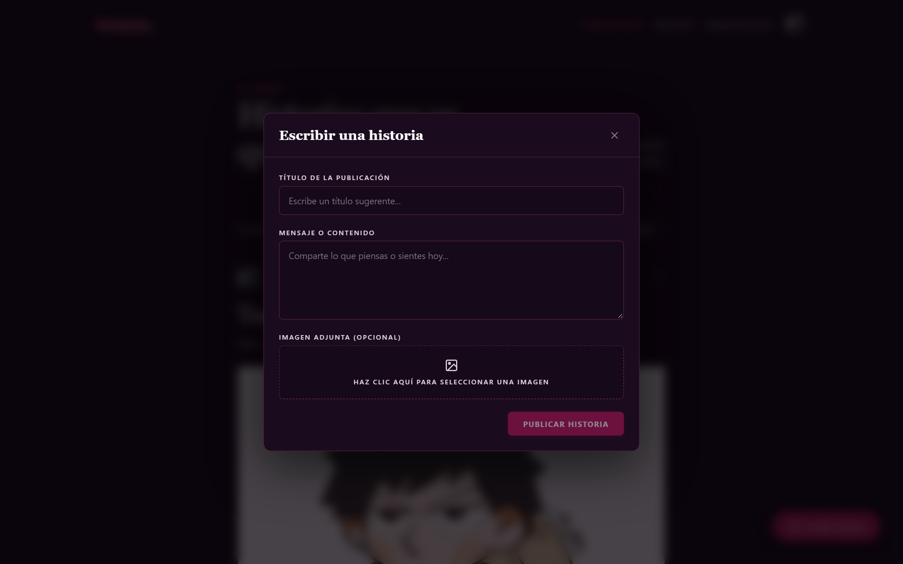

### 3.5. Pantalla de detalle de publicación (`/posts/:id`)
* **Propósito:** Experiencia de lectura inmersiva y completa de una historia individual con su conversación comunitaria.
* **Características:**
  * Presentación tipográfica generosa a página completa con metadatos del autor y fecha de publicación.
  * Barra de acciones con contador de «me gusta», botón para copiar enlace al portapapeles y botón de eliminación para el autor o administradores con modal de confirmación.
  * Sección integral de comentarios: listado paginado, identificación del autor, fecha relativa y borrado lógico de aportes.
  * Formulario reactivo para publicar nuevos comentarios con validación instantánea.

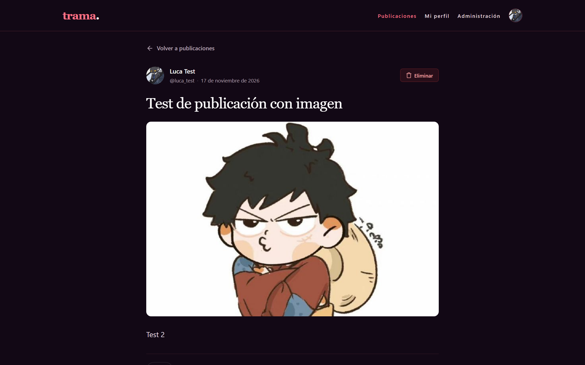

### 3.6. Pantalla de perfil personal (`/profile`)
* **Propósito:** Espacio íntimo del autor para consultar su trayectoria, estadísticas personales y archivo de publicaciones.
* **Características:**
  * Cabecera con avatar en alta definición, nombre completo, nombre de usuario, biografía y fecha de incorporación.
  * Tarjetas de métricas consolidadas: total de historias publicadas y suma de valoraciones recibidas.
  * Modal de edición de perfil para actualizar nombre, apellido, usuario, fecha de nacimiento, biografía y fotografía de perfil con previsualización inmediata.
  * Listado de historias de autoría propia con acceso directo a lectura completa o eliminación mediante confirmación modal.

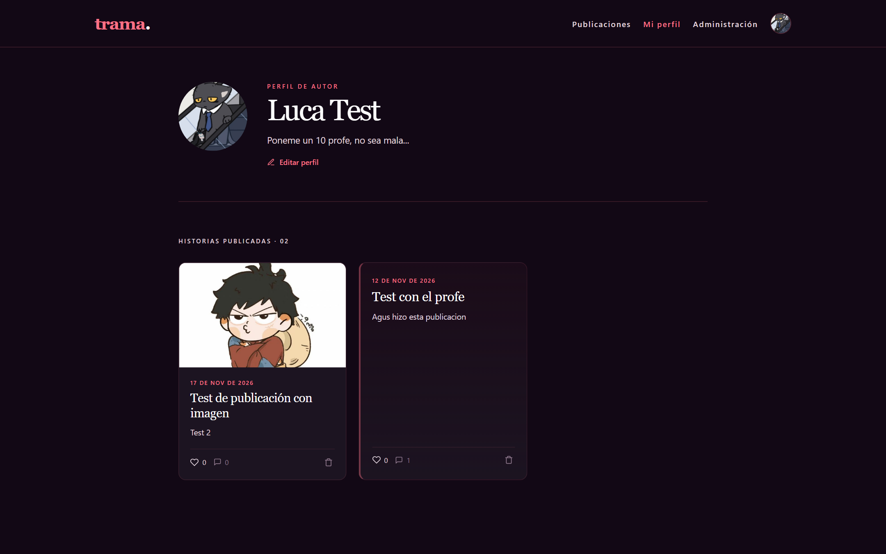

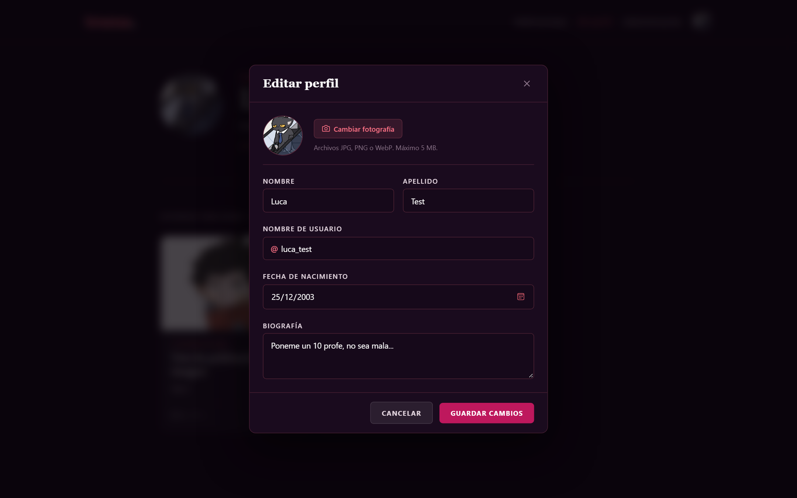

### 3.7. Panel administrativo de gestión de usuarios (`/dashboard` o `/dashboard/usuarios`)
* **Propósito:** Directorio y consola de control para la administración de integrantes de la plataforma.
* **Características:**
  * Acceso estrictamente reservado a cuentas con rol de `administrador` mediante guardia de ruta `AdminGuard`.
  * Tarjetas de indicadores globales: total de usuarios, cuentas activas, cuentas deshabilitadas y administradores.
  * Buscador reactivo en tiempo real con filtrado simultáneo por nombre, apellido, usuario o correo electrónico.
  * Tabla editorial con datos clave, insignia de rol e indicador visual de estado.
  * Control tipo interruptor (*switch*) accesible con animación CSS suave para alternar entre habilitar o deshabilitar cuentas, acompañado de un modal de confirmación con bloqueo de desplazamiento.
  * Formulario modal para el alta de nuevos usuarios desde el panel con asignación directa de rol de acceso.

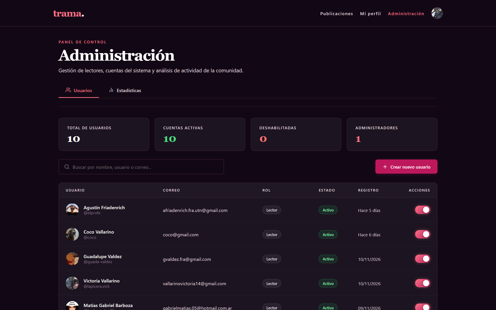

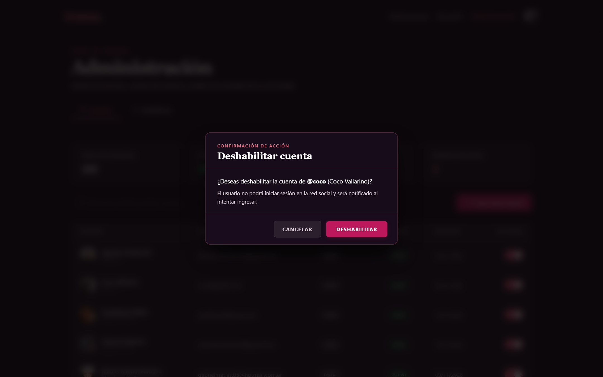

### 3.8. Panel administrativo de estadísticas y métricas (`/dashboard/estadisticas`)
* **Propósito:** Visualización analítica del rendimiento editorial y la actividad de la comunidad.
* **Características:**
  * Gráfico de barras SVG nativo: clasificación de publicaciones realizadas por autor.
  * Gráfico de línea temporal SVG nativo: evolución histórica del volumen de comentarios a lo largo del tiempo.
  * Gráfico de dona SVG nativo: proporción y distribución de comentarios recibidos por cada historia.
  * Selector interactivo de periodos: últimas 24 horas, 7 días, 30 días, 90 días, historial completo o rango de fechas personalizado.

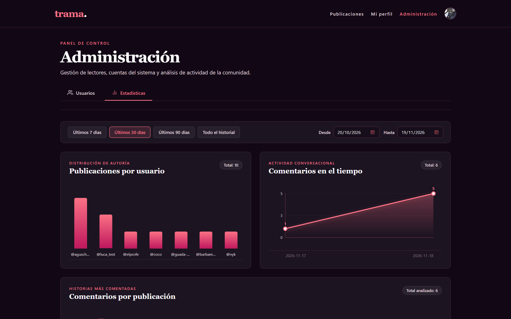

### 3.9. Modal de control y advertencia de sesión (`SessionModalComponent`)
* **Propósito:** Salvaguardar la seguridad de la cuenta informando oportunamente antes de la expiración del token JWT.
* **Características:**
  * Detección automática vinculada a la vigencia del token JWT.
  * Notificación flotante no bloqueante con diseño opaco y centrado inferior que permite continuar interactuando con la plataforma.
  * Contador dinámico destacado en tono rosa de acento.
  * Opción «Mantener sesión activa» para solicitar silenciosamente la renovación del token sin perder el contexto de navegación.
  * Opción «Cerrar sesión» para terminar la sesión de manera segura e inmediata.

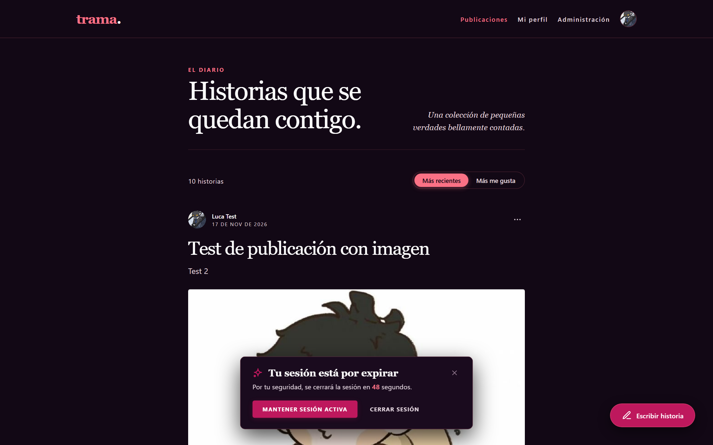

### 3.10. Barra de navegación superior (`NavbarComponent`)
* **Propósito:** Proporcionar orientación, control de identidad y navegación general por la plataforma.
* **Características:**
  * Visibilidad condicional: permanece oculta en las pantallas de acceso (`/login`, `/register`, `/loading`) y se renderiza en las vistas autenticadas.
  * Logotipo tipográfico `trama.` en fuente serif con acento en el punto final.
  * Enlace al panel de administración visible de manera exclusiva para usuarios con rol de administrador.
  * Conmutador interactivo de tema visual (modo oscuro / modo claro) con persistencia en el almacenamiento local.
  * Menú desplegable de usuario que exhibe el avatar del perfil activo y accesos para «Instalar en celular» (PWA) o «Cerrar sesión».

---

## 4. Identidad visual y diseño de interfaz

La apariencia de **Trama** fue diseñada desde cero para evocar el tacto, la calidez y el sosiego de una publicación literaria impresa, adaptada con elegancia a los medios digitales contemporáneos.

### 4.1. Decisión artística
A diferencia de las redes sociales tradicionales saturadas de notificaciones estridentes, animaciones invasivas y elementos de distracción, Trama adopta una filosofía de **diseño sosegado y contemplativo**:
* **Lectura pausada:** Espaciados generosos, contrastes cuidados para evitar la fatiga visual y ritmos verticales equilibrados.
* **Atmósfera íntima:** Fondos oscuros con tintes ciruela y moras silvestres, generando la sensación de una lectura nocturna o un diario privado.
* **Iconografía pura:** Ausencia total de emojis. Cada metáfora visual se expresa mediante vectores SVG limpios, minimalistas y de trazo uniforme.

### 4.2. Paleta de colores

La aplicación utiliza variables nativas en el selector `:root` con soporte automático para modo oscuro (por defecto) y modo claro:

| Variable CSS | Modo oscuro (por defecto) | Modo claro | Uso y significado |
| :--- | :--- | :--- | :--- |
| `--bg-app` | `#120815` | `#fff8f8` | Fondo principal de la aplicación; tono ciruela muy oscuro / blanco cálido |
| `--bg-surface` | `rgba(38, 16, 43, 0.7)` | `#ffffff` | Fondo de tarjetas y paneles translúcidos con desenfoque de fondo |
| `--border-surface` | `rgba(251, 113, 133, 0.2)` | `#f3e2e6` | Límites sutiles para delimitar contenedores sin saturar la vista |
| `--bg-input` | `rgba(18, 8, 21, 0.5)` | `#fff1f2` | Fondo de campos de texto e inputs de formularios |
| `--border-input` | `rgba(251, 113, 133, 0.24)` | `#f3e2e6` | Contorno reposado de campos interactivos |
| `--color-primary` | `#be185d` | `#be185d` | Rosa frambuesa profundo para botones de acción principal |
| `--color-primary-hover`| `#d81b60` | `#9d174d` | Realce interactivo al posar el cursor sobre acciones primarias |
| `--color-accent` | `#fb7185` | `#be185d` | Rosa pétalo luminoso para destaques tipográficos, focos e iconos |
| `--color-accent-subtle`| `rgba(251, 113, 133, 0.15)` | `#fce7f3` | Fondos de avatares, halos decorativos y estados secundarios |
| `--text-muted` | `#e2d4de` | `#8f788d` | Texto secundario, descripciones y etiquetas descriptivas |
| `--text-placeholder` | `#8f788d` | `#a995a5` | Textos de referencia dentro de campos de entrada y pies de tarjeta |
| `--color-error` | `#f43f5e` | `#e11d48` | Señalización sobria de errores de validación y campos requeridos |

### 4.3. Tipografía

La jerarquía tipográfica equilibra tradición literaria con precisión técnica:
* **Familia serif editorial (`--font-serif`):** `Georgia, 'Times New Roman', serif`. Empleada en el logotipo `trama.`, títulos principales (`.editorial-title`), frases destacadas y citas reflexivas, transmitiendo solemnidad y calidez artesanal.
* **Familia sans-serif de interfaz (`--font-sans`):** `system-ui, -apple-system, 'Segoe UI', Roboto, sans-serif`. Utilizada en formularios, etiquetas, botones, mensajes informativos y tablas de datos para maximizar la legibilidad y nitidez en pantallas de cualquier densidad.

### 4.4. Diseño y arquitectura de componentes

* **CSS nativo exclusivo:** No se emplean librerías utilitarias externas como Tailwind CSS ni Bootstrap. Toda la maquetación se fundamenta en CSS moderno con CSS Grid, Flexbox, variables personalizadas y consultas de medios (*media queries*).
* **Superficies y elevación:** Las tarjetas utilizan la propiedad `backdrop-filter: blur(18px)` junto con sombras suaves y profundas (`box-shadow: 0 24px 80px rgba(0, 0, 0, 0.35)`), logrando una sensación de capas flotantes sobre el fondo envolvente.
* **Microinteracciones cuidadas:** Las transiciones de color, foco y elevación son sutiles (entre `0.2s` y `0.3s`), ofreciendo retroalimentación inmediata sin estridencias.
* **Formularios reactivos con accesibilidad integrada:** Cada control cuenta con su respectiva etiqueta semántica `<label>`, textos guía y zonas de error accesibles (`role="alert"` y `<small class="field-error">`).

---

## 5. Instrucciones de instalación y puesta en marcha

### Requisitos previos
* **Node.js:** Versión 20 o superior.
* **MongoDB:** Servidor local ejecutándose en el puerto estándar `27017` o cadena de conexión configurada mediante la variable `MONGODB_URI`.

### 5.1. Instalación de dependencias
Desde la raíz del repositorio, instalar los paquetes del backend y del frontend:
```bash
npm install
npm --prefix frontend install
```

### 5.2. Ejecución simultánea (recomendada)
Para levantar tanto la API en NestJS como la aplicación en Angular en un único comando concurrente:
```bash
npm run start:all
```

### 5.3. Ejecución en terminales separadas
* **Terminal 1 - Servidor NestJS:**
  ```bash
  npm run start:dev
  ```
  *Disponible en: `http://localhost:3000`*

* **Terminal 2 - Cliente Angular:**
  ```bash
  npm run start:frontend
  ```
  *Disponible en: `http://localhost:4200`*

### 5.4. Verificación de calidad y pruebas unitarias
* **Compilación completa:**
  ```bash
  npm run build
  npm run build:frontend
  ```
* **Ejecución de pruebas unitarias:**
  ```bash
  npm test
  npm --prefix frontend test -- --watch=false
  ```

### 5.5. Guía de verificación y prueba de la Progressive Web App (PWA)

La aplicación incorpora soporte nativo para **Progressive Web App** mediante `@angular/service-worker` y el manifiesto web estandarizado (`manifest.webmanifest`), permitiendo instalar la plataforma como una aplicación de escritorio o móvil independiente con ejecución a pantalla completa y soporte de caché para recursos estáticos.

Dado que los navegadores exigen el protocolo seguro HTTPS o el origen `localhost` con la compilación de producción para habilitar el *Service Worker*:

#### Prueba local en entorno de desarrollo:
1. Generar la compilación optimizada de producción del cliente:
   ```bash
   npm --prefix frontend run build
   ```
2. Servir la carpeta de salida generada (`frontend/dist/frontend/browser`) mediante un servidor HTTP estático (por ejemplo, con `npx serve` o `http-server`):
   ```bash
   npx serve -s frontend/dist/frontend/browser -p 8080
   ```
3. Abrir en Google Chrome o Microsoft Edge la dirección `http://localhost:8080`.
4. Abrir las herramientas de desarrollo (*DevTools*, tecla F12) y dirigirse a la pestaña **Aplicación** (*Application*):
   * En la sección **Manifiesto** (*Manifest*): verificar que se carguen el nombre «Trama», el color de tema ciruela y los iconos adaptables.
   * En la sección **Trabajadores de servicio** (*Service Workers*): confirmar que el archivo `ngsw-worker.js` figure en estado activo y en ejecución.
5. Observar en el extremo derecho de la barra de direcciones del navegador el icono de instalación («Instalar Trama»). Al pulsar dicho botón, la aplicación se abrirá en una ventana autónoma sin barras del navegador.

#### Prueba en dispositivos móviles con el sitio desplegado en producción:
1. Una vez desplegada la aplicación en un servidor accesible bajo HTTPS (por ejemplo en Vercel, Netlify, Render o Railway):
2. **En dispositivos Android (Google Chrome):**
   * Abrir la dirección web de Trama.
   * El navegador desplegará automáticamente el aviso emergente inferior «Agregar Trama a la pantalla principal» o se podrá presionar el menú de tres puntos y seleccionar «Instalar aplicación».
   * La aplicación creará un icono propio en el cajón de aplicaciones y abrirá la experiencia a pantalla completa sin los controles del navegador.
3. **En dispositivos iOS (Apple Safari):**
   * Abrir la URL en Safari.
   * Presionar el botón de compartir (icono de cuadro con flecha hacia arriba).
   * Elegir la opción «Agregar a la pantalla de inicio».

---

## 6. Arquitectura y catálogo de rutas de la API

La API REST del backend en NestJS expone los siguientes módulos y puntos de enlace (*endpoints*):

| Módulo | Método | Ruta | Acceso | Descripción del servicio |
| :--- | :--- | :--- | :--- | :--- |
| **Autenticación** | `POST` | `/api/auth/register` | Público | Alta y registro de nuevos usuarios en la plataforma |
| | `POST` | `/api/auth/login` | Público | Validación de credenciales y emisión de token JWT |
| | `GET` | `/api/auth/authorize` | Autenticado | Verificación del estado de sesión y rol del usuario actual |
| | `POST` | `/api/auth/refresh` | Autenticado | Renovación preventiva del token JWT de acceso |
| **Usuarios** | `GET` | `/api/users/profile` | Autenticado | Consulta de información detallada del perfil propio |
| | `PUT` | `/api/users/profile` | Autenticado | Actualización de datos personales y fotografía de perfil |
| | `GET` | `/api/users/admin/all` | Administrador | Listado integral de usuarios registrados con métricas |
| | `POST` | `/api/users/admin/create` | Administrador | Creación administrativa de usuarios con rol asignado |
| | `PATCH` | `/api/users/admin/:id/toggle-status` | Administrador | Habilitación o deshabilitación lógica de una cuenta |
| **Publicaciones** | `GET` | `/api/posts` | Autenticado | Feed paginado de historias con soporte de ordenamiento |
| | `POST` | `/api/posts` | Autenticado | Creación de una nueva historia con imagen opcional |
| | `GET` | `/api/posts/:id` | Autenticado | Consulta detallada de una publicación individual |
| | `DELETE` | `/api/posts/:id` | Autor / Admin | Eliminación lógica de una historia |
| | `POST` | `/api/posts/:id/like` | Autenticado | Registro o retiro reactivo de la valoración «me gusta» |
| **Comentarios** | `GET` | `/api/posts/:id/comments` | Autenticado | Listado paginado de comentarios de una historia |
| | `POST` | `/api/posts/:id/comments` | Autenticado | Publicación de un nuevo comentario en una historia |
| | `DELETE` | `/api/posts/:id/comments/:commentId` | Autor / Admin | Borrado lógico de un comentario |
| **Estadísticas** | `GET` | `/api/stats/summary` | Administrador | Métricas agregadas y datos para gráficos de análisis |
